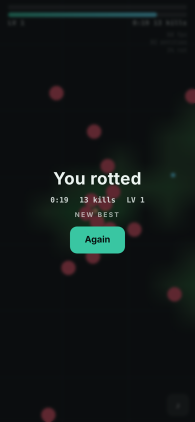

# Rot

**[Play it in your browser](https://emil-eminov.github.io/rot/)** (one thumb on a phone, or mouse on desktop)




Survive a swarm with one thumb. The gun fires itself. Every enemy you kill
leaves poison on the ground, so playing well destroys the space you are
standing in.

## The hook

In every other survivors-like, killing is unambiguously good. Here it is a
cost. The arena closes in on you as a direct result of your own success, and
the better you play the sooner you run out of clean ground. Standing still
stops being an option long before the swarm alone would have forced you to move.

## Why this shape

The previous concept, [Chain Wreck](https://github.com/emil-eminov/chain-wreck), failed its playtest because its feedback
cycle was about sixty seconds long and most of that was spent thinking. This
one runs a cycle of seconds: kill, stain, reposition, level, repeat.

## Working on it

```
npm install
npm run dev        # play at the printed localhost URL
npm run verify     # typecheck + lint + unit tests, including the balance guards
npm run test:e2e   # Playwright browser tests; set ROT_CHROMIUM to a Chromium binary
npm run build      # static build in dist/
node scripts/build-single.mjs out.html   # one self-contained file, about 22KB
```

Every push runs `verify` and deploys the build to GitHub Pages.

## The bot

`src/game/bot.ts` plays the game competently: it flees crowds, collects gems and
steps off poison. It exists because balance cannot be tuned against a dummy that
stands still, which dies in eighteen seconds and never reaches a level up. The
balance tests in `tests/world.test.ts` run whole bot runs and assert that a run
lasts, that the first upgrade arrives quickly, and that the player actually ends
up fighting on their own poison. That last one caught the hook being invisible:
an earlier decay rate left rot coverage at exactly zero while every other test
still passed.

## Size

About 22KB as a single self-contained HTML file, with no dependencies at all.
The previous 3D project was 3.25MB. A playable ad has to start before the
viewer scrolls past it.

## How this was built

Game design, direction and playtesting by me (Emil Eminov); implementation written with an AI pair-programmer (Claude) to my spec. Rot was the second concept in a build-test-kill loop and was followed by [Lanista](https://github.com/emil-eminov/lanista).
